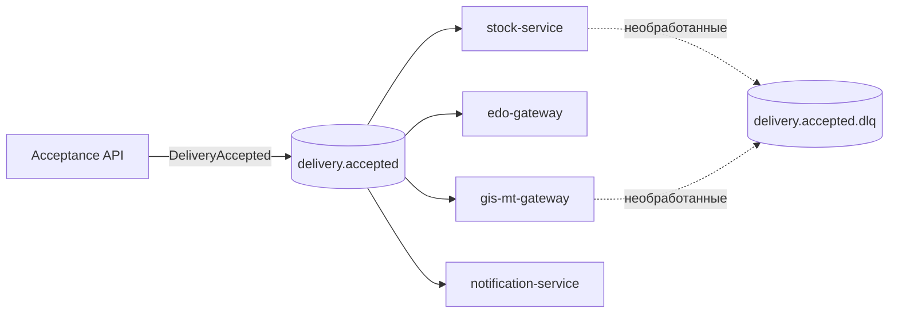

# Delivery Events: событийная интеграция приёмки маркированной поставки (Kafka)

Учебный проект системного аналитика. Описывает, **как и почему** факт приёмки маркированной поставки передаётся остальным компонентам через Apache Kafka, а не прямыми REST-вызовами.

Проект дополняет репозиторий с проектированием синхронного API приёмки (OpenAPI, BPMN): там описан запрос `POST /deliveries/{deliveryId}/acceptance`, здесь описано, что происходит **после** успешной приёмки.

> Статус: черновик. Значения параметров (партиции, retention и т.д.) приняты как допущения и обоснованы в ADR; в реальном проекте их уточняют по нагрузке.

## 1. Контекст и проблема

После приёмки поставки о ней должны узнать несколько компонентов контура:

| Потребитель | Что делает с событием |
|---|---|
| `stock-service` | увеличивает остатки |
| `edo-gateway` | подтверждает документ контрагенту через ЭДО |
| `gis-mt-gateway` | передаёт данные о приёмке в ГИС МТ |
| `notification-service` | уведомляет ответственного |

Если модуль приёмки вызывает каждого потребителя напрямую по REST, возникает **сильная связанность**: приёмка зависит от доступности каждого получателя (особенно внешних шлюзов), добавление нового получателя требует менять модуль приёмки, а медленный получатель тормозит всю цепочку.

## 2. Решение

Модуль приёмки публикует одно событие `DeliveryAccepted` в топик Kafka и не знает о потребителях. Каждый потребитель читает топик в своей consumer group, независимо и в своём темпе.



## 3. Ключевые решения и почему они приняты

Подробности и альтернативы в `docs/adr/`.

| # | Решение | Почему | Что отвергнуто |
|---|---|---|---|
| [001](docs/adr/001-event-driven-instead-of-direct-rest.md) | Асинхронные события через Kafka | Развязка отправителя и получателей, устойчивость к сбоям внешних шлюзов, несколько независимых потребителей, возможность перечитать историю | Прямые REST-вызовы; RabbitMQ |
| [002](docs/adr/002-partition-key-deliveryId.md) | Ключ сообщения `deliveryId` | События одной поставки попадают в одну партицию и сохраняют порядок | Случайный ключ; ключ по получателю |
| [003](docs/adr/003-at-least-once-idempotent-consumers.md) | At-least-once + идемпотентные потребители | Потеря события недопустима; дубли неизбежны и обрабатываются через `eventId` | At-most-once; опора на exactly-once для внешних систем |
| [004](docs/adr/004-retries-and-dlq.md) | Повторы и dead letter topic | Временный сбой не должен блокировать партицию, постоянная ошибка не должна теряться | Бесконечные повторы; тихий пропуск |
| [005](docs/adr/005-schema-and-versioning.md) | Контракт события в JSON Schema, версия в `eventVersion` | Потребители независимы, контракт нужно менять без поломки | Схема «по договорённости» без описания |

## 4. Контракт события

- Описание канала: [`asyncapi.yaml`](asyncapi.yaml)
- Схема сообщения: [`schemas/delivery-accepted.v1.json`](schemas/delivery-accepted.v1.json)

Пример:

```json
{
  "eventId": "7c9e6679-7425-40de-944b-e07fc1f90ae7",
  "eventType": "DeliveryAccepted",
  "eventVersion": 1,
  "occurredAt": "2026-10-24T10:15:30Z",
  "deliveryId": "3f2b8c1e-0000-0000-0000-000000000000",
  "items": [{ "gtin": "04600000000000", "quantity": 120 }]
}
```

## 5. Нефункциональные требования (допущения)

| Параметр | Значение | Обоснование |
|---|---|---|
| Партиций в топике | 6 | Запас по параллелизму потребителей; количество можно увеличить, уменьшить нельзя |
| Фактор репликации | 3 | Переживает отказ одного брокера без потери данных |
| `acks` у производителя | `all` | Потеря факта приёмки недопустима |
| Retention | 7 дней | Достаточно для восстановления после сбоя и повторной обработки |
| Идемпотентность потребителя | по `eventId` | Защита от дублей при at-least-once |

## 6. Открытые вопросы

- **Атомарность записи в БД и публикации события.** Если приёмка записана в базу, а событие не опубликовано (или наоборот), данные расходятся. Типовое решение: паттерн Transactional Outbox. Нужно описать отдельным ADR.
- Нужен ли строгий порядок между событиями разных поставок (сейчас не нужен).
- Политика совместимости схем и инструмент (Schema Registry или проверка в CI).

## 7. Структура репозитория

```
.
├── README.md
├── asyncapi.yaml
├── schemas/
│   └── delivery-accepted.v1.json
└── docs/adr/
    ├── 001-event-driven-instead-of-direct-rest.md
    ├── 002-partition-key-deliveryId.md
    ├── 003-at-least-once-idempotent-consumers.md
    ├── 004-retries-and-dlq.md
    └── 005-schema-and-versioning.md
```
